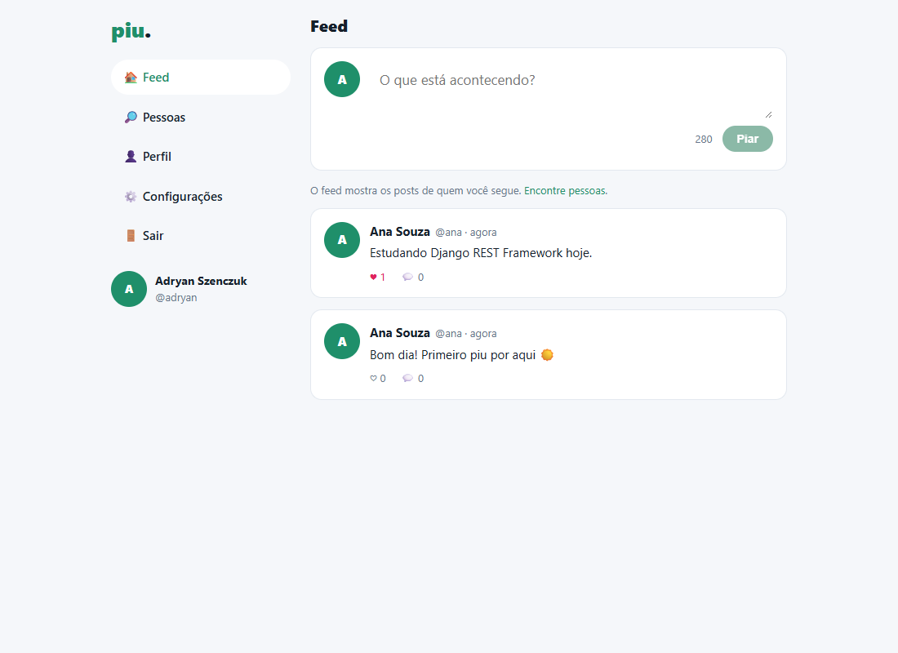
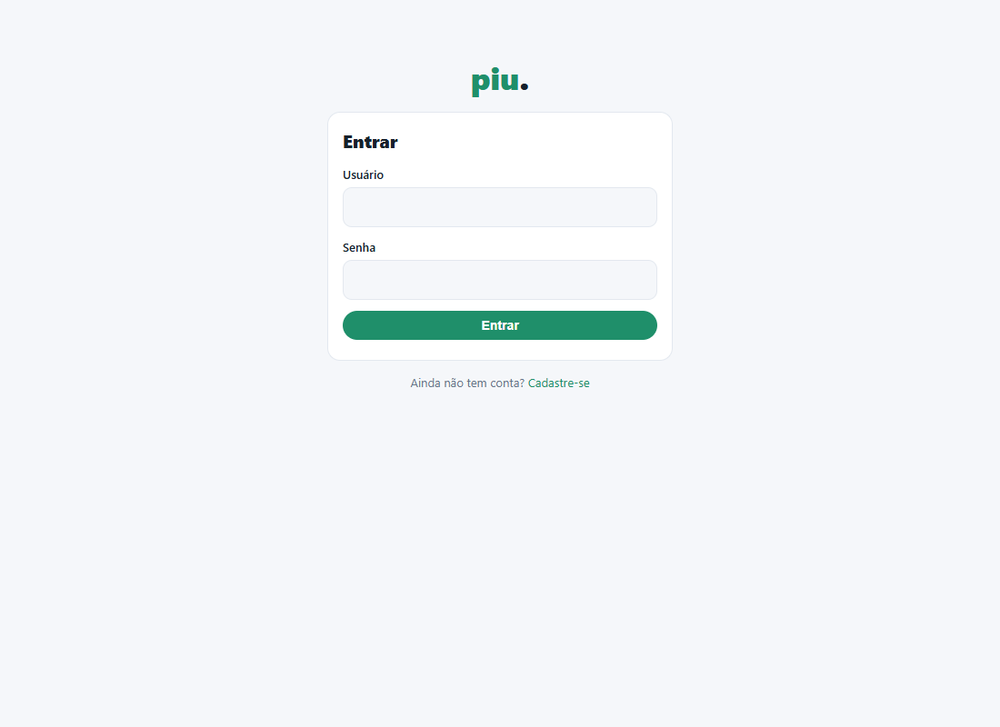
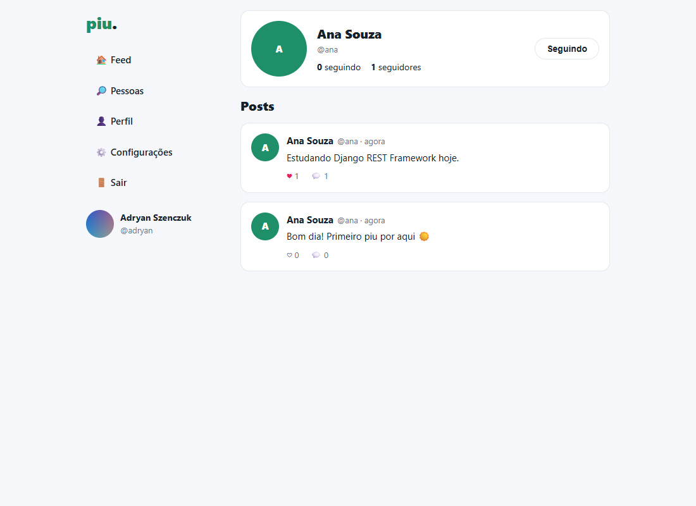
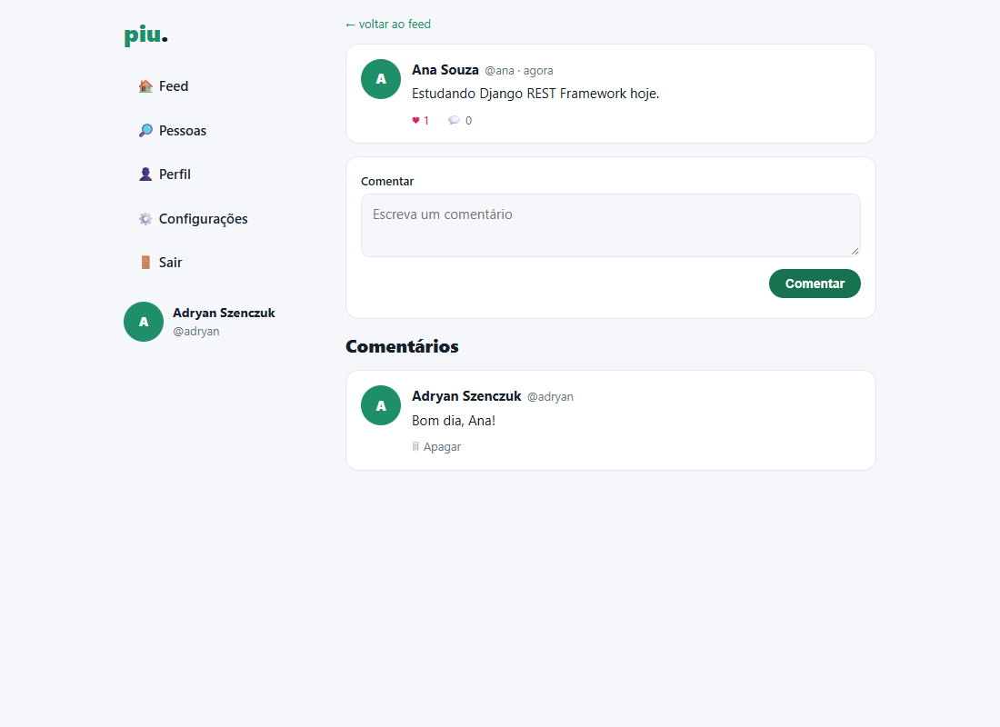
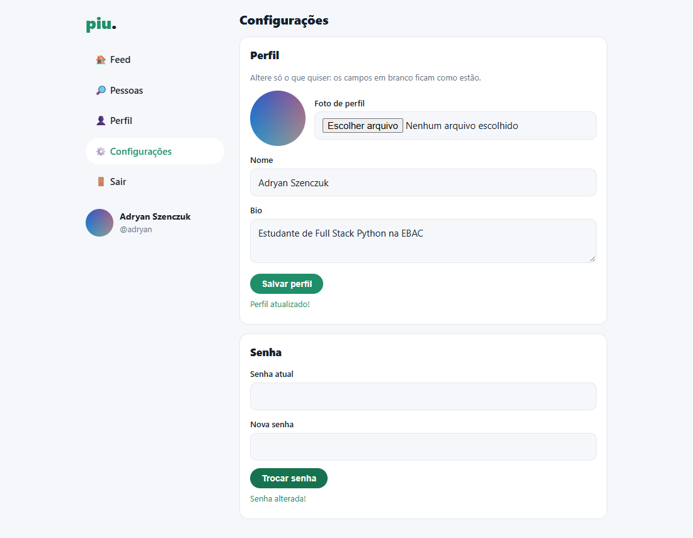
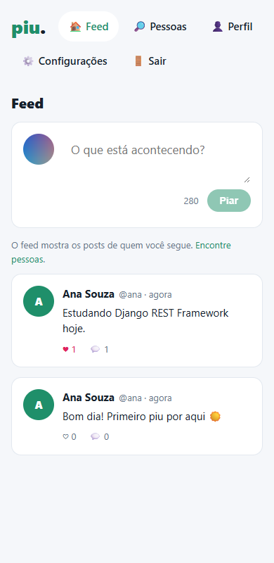

# piu. · clone do Twitter em Django

[](https://github.com/adryanszencz/twitter-clone/actions/workflows/ci.yml)

Rede social de microblog (inspirada no Twitter) feita com **Django + Django REST Framework**.
É o Projeto Final do curso Profissão: Desenvolvedor Full Stack Python, da EBAC.

**Autor:** Adryan Szenczuk
**Deploy:** https://adryantwitter.pythonanywhere.com/



## Funcionalidades

- **Conta:** cadastro e login. A API autentica por token, e a senha é validada pelos validadores do Django.
- **Perfil:** trocar a foto, o nome, a bio e a senha. Nada é obrigatório; só muda o que o usuário enviar.
- **Seguir:** seguir e deixar de seguir, com as listas de seguidores e seguidos e a busca de pessoas.
- **Feed:** só os posts de quem o usuário segue, do mais novo para o mais antigo, com paginação.
- **Posts:** de até 280 caracteres. Só o autor apaga.
- **Interações:** curtidas (uma por pessoa) e comentários. O autor do comentário pode apagá-lo.

## Arquitetura

O projeto é monolítico, com a API REST separada das telas:

- `accounts/`: usuário customizado (nome, bio, foto), seguir/seguidores e as rotas de autenticação e perfil.
- `posts/`: posts, curtidas, comentários e feed.
- `templates/` + `static/`: o front-end. As páginas são templates do Django que consomem a API com JavaScript (`fetch`), guardando o token no navegador.
- `config/`: configurações, rotas e as páginas.

As configurações vêm de variáveis de ambiente: `DEBUG`, `SECRET_KEY`, `DJANGO_ALLOWED_HOSTS` e o banco em `SQL_ENGINE`, `SQL_DATABASE`, etc. Sem elas, o projeto usa SQLite.

### Endpoints da API (`/api/`)

| Método | Rota | O que faz |
|---|---|---|
| POST | `/api/auth/register/` | cadastro (devolve o token) |
| POST | `/api/auth/login/` | login (devolve o token) |
| POST | `/api/auth/logout/` | invalida o token |
| GET, PATCH | `/api/users/me/` | ver/editar o próprio perfil (nome, bio, foto) |
| POST | `/api/users/me/password/` | trocar a senha (senha atual + nova) |
| GET | `/api/users/?search=` | buscar pessoas |
| GET | `/api/users/{username}/` | perfil público com contadores |
| POST, DELETE | `/api/users/{username}/follow/` | seguir / deixar de seguir |
| GET | `/api/users/{username}/followers/` e `/following/` | seguidores e seguidos |
| GET | `/api/users/{username}/posts/` | posts de uma pessoa |
| GET | `/api/feed/` | feed de quem o usuário segue |
| POST | `/api/posts/` | novo post |
| GET, DELETE | `/api/posts/{id}/` | ver / apagar (só o autor) |
| POST, DELETE | `/api/posts/{id}/like/` | curtir / descurtir |
| GET, POST | `/api/posts/{id}/comments/` | listar / comentar |
| DELETE | `/api/comments/{id}/` | apagar o próprio comentário |

As rotas pedem `Authorization: Token <token>`, menos cadastro e login.

## Como rodar

### Com Poetry (SQLite)

```bash
poetry install
poetry run python manage.py migrate
poetry run python manage.py runserver
```

Abra http://127.0.0.1:8000/ e crie uma conta.

### Com Docker (Postgres)

```bash
docker compose up -d --build
docker compose exec web python manage.py migrate
```

### Testes

```bash
poetry run python manage.py test
```

O GitHub Actions roda o flake8, checa as migrações e roda os testes contra um Postgres em todo PR e em todo push na `main`.

## Deploy (PythonAnywhere)

No console Bash:

```bash
git clone https://github.com/adryanszencz/twitter-clone.git
cd twitter-clone
python3.12 -m venv ~/env && source ~/env/bin/activate
pip install poetry==2.5.1 && poetry install --no-root
python manage.py migrate && python manage.py collectstatic --noinput
```

Na aba **Web**:
1. Crie uma web app em "Manual configuration", com Python 3.12.
2. Configure o virtualenv `~/env`.
3. Mapeie os arquivos estáticos: `/static/` para `staticfiles` e `/media/` para `media`.
4. No arquivo WSGI, defina `DJANGO_SETTINGS_MODULE=config.settings`, `DEBUG=0` e `DJANGO_ALLOWED_HOSTS` com o domínio.

## Telas

| Login | Feed | Perfil |
|---|---|---|
|  |  |  |

| Post e comentários | Configurações | Celular |
|---|---|---|
|  |  |  |
